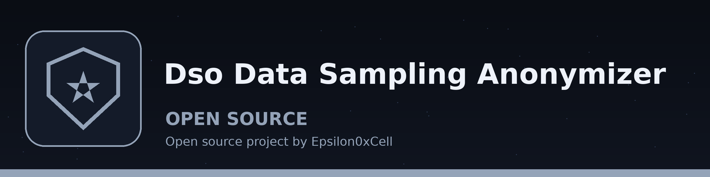

# dso-data-sampling-anonymizer
Randomly samples rows or columns from a dataset and replaces sensitive information in the sampled data with dummy values, reducing the size of the dataset while preserving statistical properties for testing purposes. - Focused on Tools for sanitizing and obfuscating sensitive data within text files and structured data formats

## Install
`git clone https://github.com/ShadowGuardAI/dso-data-sampling-anonymizer`

## Usage
`./dso-data-sampling-anonymizer [params]`

## Parameters
- `-h`: Show help message and exit
- `-i`: Path to the input CSV file.
- `-o`: Path to the output CSV file.
- `-s`: Fraction of rows to sample, greater than 0.0 and at most 1.0. A sample size of 0 is rejected with exit code 1.
- `-c`: List of column names to anonymize.
- `--no_header`: Specify if the CSV file does not have a header row.
- `-e`: Encoding of the input CSV file (e.g., 
- `-d`: Delimiter used in the CSV file

## Output rules
- The output file must not be the input file. If the resolved output path is the same as the resolved input path, including a `./` alias or a symlink to the input, the run refuses with exit code 1 before any write and the input file is left unchanged. Sampling writes only the sampled rows, so writing over the input would discard every unsampled row.
- If no rows are sampled, for example from a header only input, the run prints a plain `No rows sampled` line, writes no output, prints no success line, and exits non-zero.

## License
Copyright (c) ShadowGuardAI
